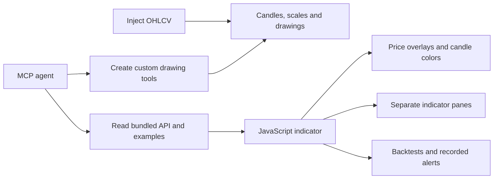

# Opennanchart

<a href="https://opennan.com/"></a>

Created and maintained by **[Opennan](https://opennan.com/)**.
Company and original author credits are preserved in [CREDITS.md](CREDITS.md).

[JavaScript API](docs/javascript-api.md) · [Pine-to-JavaScript](docs/pine-to-javascript.md) · [Custom tools](docs/custom-tools.md) · [MCP agent guide](docs/mcp.md)

A dark, embeddable React/canvas candlestick chart with JavaScript indicators,
next-open backtesting and an MCP bridge. Built from the original TradingReact
chart, with Opennan's visual identity.

## Create indicators in JavaScript

Choose **Load example → Madrid Bull Bear Sentiment** for an oscillator in a
separate pane, or **Bearish Engulfing** for yellow signal candles on the price
chart. **Settings → Apply & run** edits numeric/checkbox inputs. The examples
also include MACD columns, Donchian fills and Supertrend candle colors.



Plots support lines, opaque/translucent areas, histograms, columns, circles,
crosses, dotted levels and per-bar colors. Scripts can color candles/backgrounds,
draw signal shapes and fill between plots. Use `indicator({name, overlay:false})`
for a separate pane. [Follow the JavaScript guide](docs/javascript-api.md) or
[translate a Pine formula](docs/pine-to-javascript.md).

The left rail groups related tools in pop-out menus. **Workspace settings** lets
you hide/show each section; **Expand chart** opens a full-chart view. Escape or
**Exit full chart** restores the previous layout. **Restore workspace** resets
hidden sections. Settings are saved locally.

## Run locally

Requires Node 20.19+ and npm.

```sh
npm install
npm run build
npm start
```

Open **http://127.0.0.1:3031/**. The built workspace and local agent bridge run
in the same process. The demo starts with clearly labelled, deterministic
sample candles; use Data to import your own JSON/CSV or fetch public Binance
spot candles. Public exchange availability depends on your network and region.

For development, run `npm run dev:bridge` and `npm run dev` in separate terminals,
then open http://127.0.0.1:3030/.

## What works

- Candles, line, area and Heikin Ashi display.
- Scroll zoom, drag-to-pan, draggable price scale, autoscale, fit, log and percent scales.
- Trend, horizontal and vertical lines, Fibonacci retracement, rectangles, circles,
  measurements and long/short position drawings; selection, editing and deletion.
- Candle replacement, appending and streaming updates through JavaScript, REST and MCP.
- Built-in SMA, EMA, Wilder RSI, Wilder ATR, Bollinger bands, rolling extremes and standard deviation.
- Custom JavaScript plots on the price chart or a synchronized indicator pane.
- Long/short strategy backtests, filled-trade markers, equity, drawdown, costs and trade history.
- A local JavaScript editor with examples, saved drafts, recoverable errors and cancellation.
- Real stdio MCP tools connected to the visible browser workspace.

This is the first Opennanchart release, not a replacement for every TradingView
feature. It does not implement Pine Script, exchange order placement,
multi-position portfolios, limit/stop fills, an exchange datafeed service or
TradingView's proprietary libraries. Chart drawings use pointer interactions;
the surrounding controls and code editor support keyboard input.

## Embed with JavaScript

The package is prepared for npm distribution. Until a registry release exists,
install directly from the public source (npm builds it through `prepare`):

```sh
npm install github:Opennan/opennanchart react react-dom
```

Or build and install its local archive:

```sh
npm pack
# In your app:
npm install /path/to/opennanchart-0.1.0.tgz react react-dom
```

```js
import { createChart } from 'opennanchart';

const chart = createChart(document.querySelector('#chart'), { height: 500 });
chart.setData([
  { time: 1700000000000, open: 100, high: 106, low: 98, close: 104, volume: 120 },
  { time: 1700003600000, open: 104, high: 110, low: 103, close: 108, volume: 180 },
]);
chart.updateCandle({
  time: 1700003600000, open: 104, high: 111, low: 103, close: 109, volume: 190,
});
chart.appendData([
  { time: 1700007200000, open: 109, high: 112, low: 107, close: 110, volume: 150 },
]);
chart.setScaleMode('log'); // linear | log | percent
chart.setChartStyle('candles'); // candles | line | area | heikin-ashi
chart.setTool('LineTool:Segment');
chart.fitContent();
// chart.destroy();
```

Your container must have nonzero dimensions. Object candles and
`[time, open, high, low, close, volume]` tuples are accepted. **Time is Unix
milliseconds.** Data must be finite, positive-price OHLCV, chronological and
unique, with nonnegative volume. An update may replace the latest timestamp or
append a newer one; historical corrections use `setData`.

The chart supports up to 10,000 candles. `setData` resets the viewport and
drawings. `updateCandle` preserves scale, drawings and the time-window span;
appends follow the end only if you were already viewing it.

Other methods: `getData`, `resetScale`, `zoom`, `getVisibleRange`,
`setVisibleRange`, `getDrawings`, `setDrawings`, `clearDrawings`, `runScript`,
`addIndicator`, `updateIndicator`, `removeIndicator`, `setIndicatorVisibility`,
`getIndicators`, `clearScript`, `registerTool`, `getCustomTools` and `exportImage`. Plot results are snapshots: rerun a custom
script after changing its data. Built-in workspace studies recalculate as
candles change.

A self-contained browser build, including React, is emitted at
`dist/demo/opennanchart.js`. With the built workspace running you can also embed
it without a bundler:

```html
<div id="chart" style="height:500px"></div>
<script src="http://127.0.0.1:3031/opennanchart.js"></script>
<script>
  const chart = OpennanChart.createChart(document.querySelector('#chart'));
  chart.setData(myCandles);
</script>
```

## Embed with React

```tsx
import { useRef } from 'react';
import { OpenNanChart, type OpenNanChartHandle } from 'opennanchart';

function Chart({ candles }) {
  const chart = useRef<OpenNanChartHandle>(null);
  return <OpenNanChart ref={chart} data={candles} height={500} scaleMode="linear" />;
}
```

Use a stable `data` array when streaming through the ref. Replacing the `data`
prop is a full dataset replacement. `activeTool` and `onToolChange` allow your
own drawing rail. `onDataChange`, `onDrawingsChange`, `onHover`, `onViewChange`
and `onScaleChange` expose chart activity. `colors` customizes the palette.

## JavaScript indicators and strategies

```js
const fastLength = input.int('Fast length', 12, { min: 2, max: 200 });
const slowLength = input.int('Slow length', 30, { min: 3, max: 300 });

onBar(({ ta, plot, strategy }) => {
  const fast = ta.sma(fastLength);
  const slow = ta.sma(slowLength);
  plot('Fast SMA', fast, { color: '#7dd3fc' });
  plot('Slow SMA', slow, { color: '#c4b5fd' });
  plot('RSI', ta.rsi(14), { color: '#c4b5fd', pane: 'indicator' });
  if (ta.crossover(fast, slow)) strategy.entry('long');
  if (ta.crossunder(fast, slow)) strategy.close();
});
```

`onBar` receives the current `index`, `time`, `open`, `high`, `low`, `close`,
`volume`, plus `history(field, barsAgo)`, `ta`, `plot` and `strategy`. History
lookbacks must be nonnegative. Indicators return `null` until their warmup is
complete. Call crossover/crossunder every bar, consistently, so they can compare
consecutive values. SMA and EMA periods are integers from 1 to 5,000.

- `ta.sma(period, source?)`, `ta.ema(period, source?)`
- `ta.rsi(period = 14, source?)`, `ta.atr(period = 14)`
- `ta.bbands(period = 20, multiplier = 2)` → `{ upper, middle, lower }`
- `ta.highest(period, source = 'high')`, `ta.lowest(period, source = 'low')`
- `ta.stdev(period, source = 'close')`
- `ta.crossover(a, b, key?)`, `ta.crossunder(a, b, key?)`
- `strategy.entry('long' | 'short')`, `strategy.close()`
- `strategy.position`, `strategy.equity`
- `input.int(name, defaultValue, { min, max, step, editable })`, `input.number(...)`, `input.bool(...)`
- `log(...values)` for bounded, returned script logs.

Plots accept a CSS color name, hex, rgb() or hsl() color and a `price` or
`indicator` pane. A script can create 20 plots and 32 numeric or boolean inputs. Register
one synchronous `onBar` callback. The last order requested on a bar wins.

```js
const result = await chart.runScript(source, {
  initialCapital: 10000,
  feeBps: 10,
  slippageBps: 2,
  allocationPercent: 100,
  inputs: { 'Fast length': 9 },
});
console.log(result.metrics, result.trades);
```

`runSandboxedScript` is exported separately when you need results without
attaching them to a chart. It requires a browser, supports an AbortSignal and
terminates runaway scripts. It uses a worker inside an opaque-origin iframe;
the worker has a restrictive network CSP and no parent DOM or storage access.
Source is never evaluated by the Node MCP bridge. Browser isolation is not a
reason to run unknown scripts inside unrelated sensitive web applications.

The embedding page's CSP is inherited by the runtime iframe. Script execution
therefore requires the host to permit inline bootstrap code, eval, and blob
workers (`script-src 'unsafe-inline' 'unsafe-eval' blob:` and `worker-src blob:`).
Do not weaken a sensitive application's existing policy to accommodate this;
use a dedicated chart origin when those permissions conflict with its policy.
Chart rendering and data injection do not require eval.

The worker bootstrap and engine run in strict mode so sloppy callback stack
inspection cannot expose the complete candle array.

For **trusted Node code**, import `executeScript` from `opennanchart/engine`.
It accepts a bar callback or trusted source. Direct engine execution is not a
security sandbox; never pass it untrusted source in your server.

## Backtest model

- Evaluate each bar after its close. Orders fill at the **next** bar's open.
- Slippage worsens buys and sells. Commission applies on both entry and exit.
- Only one long or short position is open at once. A reversal closes the old
  position before opening the opposite side. Repeated same-side entries do not pyramid.
- Allocation is a fraction of current cash-equity, with no leverage or liquidation model.
- Open positions remain open and are marked to the final close. The last bar's
  signal remains pending if there is no next candle; it is not filled artificially.
- Trade P&L includes both commissions. Final equity also includes unrealized P&L.
- Drawdown uses bar-close equity relative to its running peak, starting with initial capital.
- Heikin Ashi is a display transform. Backtests use the original candles.

Every result records its capital, fee, slippage, allocation and execution model
in `result.configuration`, including results requested through MCP. Changing
workspace settings affects the next run; it does not relabel an existing run.

## MCP

Start `npm start`, open the workspace, then configure your MCP client:

```json
{
  "mcpServers": {
    "opennanchart": {
      "command": "node",
      "args": ["/absolute/path/to/opennan-chart/server/mcp.mjs"]
    }
  }
}
```

`OPENNANCHART_URL` changes the local bridge URL (default
`http://127.0.0.1:3031`). Only loopback HTTP endpoints are allowed. Multiple
workspaces can use different bridge ports with `node server/serve.mjs --port 3041`.

| Tool | Operation |
| --- | --- |
| `chart_get_state` | Read the dataset and active chart settings. |
| `chart_get_data` | Read a bounded page of OHLCV candles. |
| `chart_get_script` | Read the last successfully executed script. |
| `chart_set_data` | Inject chronological OHLCV candles and a symbol/interval. |
| `chart_update_candle` | Replace the latest candle or append the next candle. |
| `chart_set_view` | Change the scale, chart style or fit all data. |
| `chart_run_script` | Create plots or backtest using the browser sandbox. |
| `chart_get_results` | Read plots, equity, trades and metrics. |
| `chart_list_indicators` | Discover built-in studies and execution rules. |
| `chart_get_documentation`, `chart_get_example` | Read bundled guides and runnable JS examples. |
| `chart_update_parameters` | Edit one study's inputs using its `indicatorId`. |
| `chart_get_indicators` | List attached studies, IDs, visibility and inputs. |
| `chart_manage_indicator` | Hide, show or remove one study. |
| `chart_control` | Drawings, tools, custom tool registration, range, zoom and saved layouts. |
| `chart_export_image` | Return a PNG of the price chart. |

State and result tools return compact summaries by default. Request
`includeCandles` or `includeSeries` explicitly for full arrays.

The browser must be open for script execution. The MCP server dispatches work to
it and waits for results. The bridge is local, single-workspace and in-memory;
it has no account system or remote multi-tenant hosting. It binds to loopback
and rejects foreign browser origins and non-JSON mutations.

Agent scripts do not replace the editor draft. Use **Load agent script** to
explicitly bring one into the editor. On bridge reconnection, unsynchronized
local candle edits are pushed before more results are shared; a restarted
bridge is identified by its instance ID. The browser can run scripts while the
bridge is offline. Local backtest results remain visible if sharing fails.
When a restarted bridge already contains agent-loaded data and the browser has
no unsynchronized candle edits, that dataset is adopted. View changes and local
runs made while disconnected are shared after reconnection. Incoming events
and outgoing mutations are processed in order. Rejected 4xx requests show the
server's message; network retries use backoff.

The same operations are available over REST: `GET /api/state`,
`PUT /api/candles`, `POST /api/candle`, `PUT /api/view`, `POST /api/run`,
`GET /api/results`, `GET /api/indicators`, `GET /api/health`.
The demo also exposes `window.opennanchart` for local integration experiments.

## Verify and package

```sh
npm test                   # Deterministic math, execution and data checks
npm run build              # Type checking, demo, library and declarations
npm run test:browser       # Both real-browser, REST and stdio MCP suites
npm pack                   # npm-installable archive
```

Browser tests use installed Google Chrome on macOS, or Playwright Chromium
elsewhere (`npx playwright install chromium`). Set `PLAYWRIGHT_CHANNEL` to
override the browser channel. Tests use isolated local bridge data and do not
contact customers or place exchange orders.

MIT licensed. [Opennan company credits](CREDITS.md) and original attribution are retained in LICENSE and NOTICE. Bundled
dependency licenses are reproduced in THIRD_PARTY_NOTICES.md.

## Multiple indicators and workspace controls

Open **Indicators** to add more JavaScript examples alongside existing studies.
Each indicator has its own eye, settings, source and × remove controls. Separate
panes keep independent scales, including when scripts reuse plot names. Up to
20 JavaScript instances can stay attached; each calculation runs separately.

The chevron beside **Run script** collapses the bottom panel. Click it again, or
click a panel tab, to reopen it. Hover drawings to see endpoint prices, percent
change and bar counts; long/short position tools display their risk/reward values.
Indicator legends display numeric values for the hovered candle.

See the [multi-indicator JavaScript API](docs/javascript-api.md) and
[MCP management guide](docs/mcp.md) for programmatic controls.
