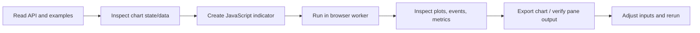

# MCP agent guide

Start `npm start` and open `http://127.0.0.1:3031/`. The browser performs chart
operations and isolated script execution; the local Node bridge never evaluates
user source. The workspace retains up to 20 independent JS indicator instances, including
price overlays and separate panes. A new source adds a study; rerunning the same
source updates its matching instance. Only one script calculation runs at a time.

```json
{
  "mcpServers": {
    "opennanchart": {
      "command": "node",
      "args": ["/absolute/path/to/opennanchart/server/mcp.mjs"]
    }
  }
}
```

An installed package also exposes the `opennanchart-mcp` executable. Set
`OPENNANCHART_URL=http://127.0.0.1:PORT` for a different local bridge. The bridge
is loopback-only and has no public remote authentication service.

## Learn before creating

- `chart_get_documentation({topic:'javascript'})`: scripting API and limits.
- Topics `pine`, `tools`, `mcp`, `overview`: translation, custom tools, workflow,
  installation/embedding.
- `chart_get_example({})`: list example IDs and descriptions.
- `chart_get_example({name:'madrid'})`: complete runnable source. Other examples
  include `engulfing`, `macd`, `channel`, `supertrend`, `rsi`, `bands`, `atr`.
- MCP resources expose the same docs at `opennanchart://docs/javascript` etc.
- The `create_indicator` MCP prompt includes API/translation guidance with the
  user's task. Resources, examples and docs work without a chart browser.

## Recommended workflow



Read `chart_get_state` before replacing data. Inspect a small page with
`chart_get_data`; do not flood the context with every candle. Use known current
and past data, preserve user drafts, and label generated fixtures clearly.

`chart_run_script({source, options:{inputs:{Length:18,Smooth:true}}})` returns
compact plot metadata, parameters, execution configuration, events and metrics.
Request `includeSeries:true` only when full arrays are needed. Inspect errors,
and revise the script rather than claiming success. The browser's editor draft
is preserved; the user explicitly loads an agent script if desired.

`chart_update_parameters({inputs:{Smooth:false}})` reruns the last successful
script with merged parameter overrides and the last execution configuration.
Author-locked inputs ignore overrides. `chart_get_script` reads the last run
source; `chart_get_results` reads results without rerunning.

## Chart and drawing control

`chart_control` takes an `action` and optional `args`:

| Action | args |
| --- | --- |
| `getVisibleRange` | none; returns `{start,end}` bar indexes |
| `setVisibleRange` | `{start:20,end:120}` |
| `zoom` | Positive factor; .8 zooms in, 1.25 zooms out |
| `resetScale`, `fitContent` | none |
| `getDrawings`, `clearDrawings` | none |
| `setDrawings` | Drawing array, replacing current drawings |
| `setTool` | Built-in or registered tool ID |
| `registerTool` | Declarative definition from [custom tool docs](custom-tools.md) |
| `getCustomTools` | none |
| `getLayout` | none; returns section visibility preferences |
| `setLayout` | Partial booleans: `header`, `toolbar`, `tools`, `editor`, `indicators`, `legend`, `status` |
| `setFullChart` | Boolean; Escape exits full-chart mode |

Commands acknowledge mutations after React commits them; a subsequent read
observes the updated state. `chart_set_view` controls `scaleMode`, `chartStyle` and
`fitContent`. Linear, log and percent scales are supported; chart styles are
candles, line, area, Heikin Ashi. Execution always uses original OHLCV.

`chart_export_image` returns a PNG image content block for the **price chart**,
including drawings and price overlays. It does not capture the code editor or
separate oscillator panes, and performs no public upload. Inspect separate-pane
numeric results or use a local browser screenshot when needed.

## Data, execution and boundaries

`chart_set_data` replaces up to 10,000 chronological, unique OHLCV candles with
Unix-millisecond timestamps. `chart_update_candle` replaces the latest matching
timestamp or appends a later candle. Replacing data clears drawings/results;
streaming keeps custom plot snapshots until rerun. Existing historical candles
are corrected by replacing the dataset.

One script job runs at a time. Strategies fill next-open with documented fees
and slippage. Alert events are local historical inspection data, not hosted
realtime notifications. No Pine compiler, arbitrary page-code evaluation,
credential access, public hosting, external messaging or exchange orders are
provided by these tools. Use the documented inputs and chart operations.

## Manage multiple studies

Call `chart_get_indicators()` to list attached instance IDs, visibility and
individual input values. `chart_update_parameters({indicatorId, inputs:{Length:21}})`
updates that study without changing the others. `chart_run_script` accepts
`indicatorId` to replace the selected instance's source. Leave it out to add a
new source or rerun an existing matching source.

Use `chart_manage_indicator({id, visible:false})` to hide a study; set
`visible:true` to restore it. `{id, remove:true}` removes only that instance.
Hidden studies retain their settings. `chart_get_results` continues to return
the most recent successful run; use the collection tool to discover all studies.
Browser reload restores the collection from the running in-memory bridge.
